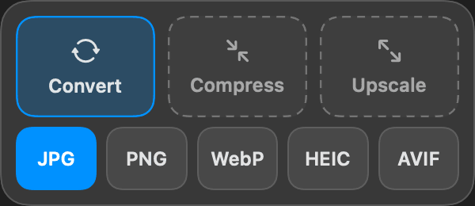
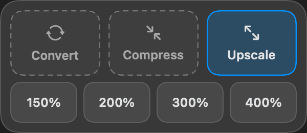
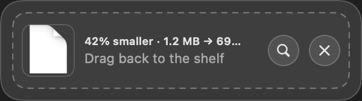

# Tack

**Convert**, **Compress** and **Upscale** boxes that appear right under Vorssaint's Shelf when you drag images. Hover a box mid-drag to see its options, drop on one, and the result lands next to the original.

> [!IMPORTANT]
> **Tack needs Vorssaint.** It's an add-on for [Vorssaint](https://vorssaint.com), a free, open-source menu bar toolkit: [download Vorssaint](https://github.com/vorssaint/vorssaint-utils/releases/latest). Vorssaint has to be running with its **Shelf** turned on in its settings. Without it Tack does nothing.

<p> </p>



- Convert to JPG, PNG, WebP, HEIC or AVIF.
- Compress (light / medium / strong); PNGs use pngquant when it's installed.
- Upscale 2× (Lanczos).
- Works on png, jpg, webp, heic, avif, tiff and bmp files, while dragging or while they sit on the Shelf.
- No menu bar icon. Open Tack again from Applications to quit it or change Open at Login.

## Requirements

- macOS 26 or later.
- **[Vorssaint](https://vorssaint.com)** ([download](https://github.com/vorssaint/vorssaint-utils/releases/latest), free and open source), running, with its **Shelf** turned on. Tack is an add-on to Vorssaint's Shelf: it finds the Shelf window on screen and reads the Shelf's file list from Vorssaint's preferences. Without Vorssaint (or with the Shelf off) Tack does nothing. Tested with Vorssaint 3.4 using shake-to-summon; the notch Shelf hasn't been tested.
- Optional, from Homebrew: `brew install webp` (needed for **WebP** output) and `brew install pngquant` (better PNG compression).

## Install

Install and open [Vorssaint](https://github.com/vorssaint/vorssaint-utils/releases/latest) first, with its Shelf turned on.

**Download:** get [Tack.zip](https://github.com/byaydenrx/Tack/releases/latest/download/Tack.zip) from the [latest release](https://github.com/byaydenrx/Tack/releases/latest) (Apple silicon and Intel, macOS 26 or later).

1. Double-click `Tack.zip` to unzip it, and drag **Tack** into your Applications folder.
2. Open it. Because the app isn't notarized by Apple, macOS says it can't verify it: click **Done**.
3. Open System Settings › Privacy & Security, scroll down to “Tack was blocked”, click **Open Anyway** and confirm. You only do this once.
4. Tack has no window or menu bar icon. Open it again from Applications to quit it or change Open at Login.

**Or build it yourself** (no Gatekeeper prompt), with Swift 6 from the Xcode Command Line Tools (`xcode-select --install`) or Xcode:

```sh
git clone https://github.com/byaydenrx/Tack.git
cd Tack
./install.sh
```

`install.sh` builds Tack, copies it to `~/Applications` and opens it. `./build.sh` only builds `build/Tack.app`.

## Data

None. Results are saved next to the original (or in `~/Downloads` if that folder is private or read-only). Log: `~/Library/Logs/Tack.log` (trimmed to the newest 256 KB once it passes 1 MB).

## Test modes

`Tack --process convert:jpg|compress:medium|upscale:2 <files>`, `--snapshot <dir>`, `--preview`.

## License

MIT — see [LICENSE](LICENSE). Vorssaint is a separate app and isn't affiliated with this project.
